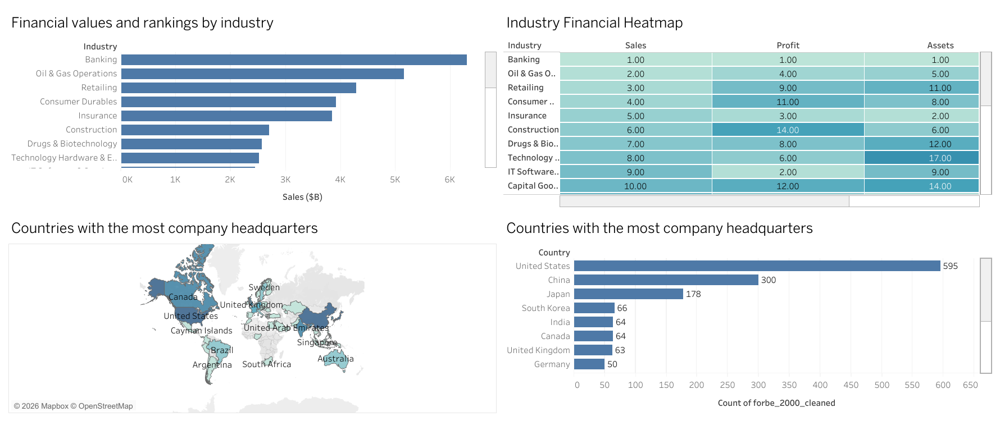

# Forbes Global 2000 Analysis

An end-to-end data analysis of the Forbes Global 2000 list: cleaning the data in Excel, exploring it with SQL, and visualizing it in a Tableau dashboard.



**Live dashboard:** [View on Tableau Public](https://public.tableau.com/app/profile/kaung.thaw/viz/ForbesGlobal2000Analysis/Dashboard1)

---

## Project Overview

The Forbes Global 2000 ranks the world's largest public companies. This project asks:

- Which **industries** lead in sales, profit, assets, and market value?
- Which **countries** are home to the most of these companies?
- Which companies earn **low profit despite high assets**?
- Which companies have **high profit relative to sales**, and which have **high sales but thin profit**?
- Which asset-heavy companies look **undervalued** (low market value relative to assets)?

## Dataset

| Item | Detail |
|---|---|
| Records | 2,000 companies |
| Countries | 63 |
| Industries | 27 |
| Fields | Company, Headquarters (City / Country), Industry, Sales, Profit, Assets, Market Value |
| Units | All financial figures in billions of USD ($B) |

Source: Forbes Global 2000 list (2026).

## Tools Used

- **Excel**: data cleaning and preparation
- **MySQL**: exploratory and ratio analysis (aggregations, window functions)
- **Tableau**: interactive dashboards

## Workflow

### 1. Data Cleaning (Excel)
The raw file stored location as a single `"City, Country"` text column. In the cleaned version, headquarters was split so each company has a separate **City** and **Country**, which makes country-level analysis possible.

- Raw: `data/Forbes_2000_raw.xlsx`
- Cleaned: `data/Forbes_2000_cleaned.xlsx` (also exported as `data/Forbes_2000.csv`)

### 2. SQL Analysis
All queries are in [`sql/Forbes_2000_analysis.sql`](sql/Forbes_2000_analysis.sql). The data was loaded into a working copy of the table first, so the original stays untouched.

| Analysis | Technique |
|---|---|
| Industry rankings by sales, profit, assets, market value | `GROUP BY`, `SUM()`, `RANK() OVER()` |
| Countries with the most headquarters | `COUNT()`, `RANK() OVER()` |
| Low profitability despite high assets | Profit-to-assets ratio |
| Highest profit relative to sales | Profit-to-sales ratio |
| High sales but low profit | Profit-to-sales ratio (ascending) |
| Undervalued asset-heavy companies | Market-value-to-assets ratio |
| Cross-financial ratios | Five ratios side by side per company |

### 3. Visualization (Tableau)
The workbook [`tableau/Forbes_2000.twb`](tableau/Forbes_2000.twb) contains two dashboards, including:

- Financial values and rankings by industry
- Industry financial heatmap
- Countries with the most company headquarters
- Low profitability despite high assets
- Highest profit-to-sales companies
- Companies with higher sales but lower profit
- Undervalued asset-heavy companies
- Cross-financial ratios heatmap

A **Top N** parameter lets the viewer change how many companies are shown.

## Key Findings

- **Geography:** 
The United States has the most headquarters on the list (595), followed by China (300) and Japan (178).

- **Industry:** 
Banking has the highest combined sales (about $6.3T) and combined profit (about $1.07T), followed by Oil & Gas Operations, then Retailing, in sales.

- **Insight:** 
Sales rank doesn’t predict profit rank.
Consumer Durables is 4th in sales but 11th in profit. Retailing is 3rd in sales and 9th in profit. Construction is 6th in sales and 14th in profit.
IT Software & Services goes the other way: 9th in sales but 2nd in profit.
Your Industry Financial Heatmap shows this directly, which makes it the easiest one to back up.

Profit margins vary a lot by industry.
Semiconductors earn about 35 cents of profit per dollar of sales, and software about 24 cents.
Food Markets earn about 2 cents, and Trading Companies about 3.
This pairs naturally with insight 2.

## Repository Structure

```
forbes-global-2000-analysis/
├── README.md
├── data/
│   ├── Forbes_2000_raw.xlsx
│   ├── Forbes_2000_cleaned.xlsx
│   └── Forbes_2000.csv
├── sql/
│   └── Forbes_2000_analysis.sql
├── tableau/
│   └── Forbes_2000.twb
└── images/
    └── dashboard.png
```

## How to Reproduce

1. Load `data/Forbes_2000.csv` into MySQL as a table named `forbe 2000`.
2. Run the queries in `sql/Forbes_2000_analysis.sql`.
3. To open the Tableau workbook, download it with the cleaned Excel file, open the `.twb` in Tableau, and if prompted, re-point the data source to `data/Forbes_2000_cleaned.xlsx`.

## Limitations

- This is a single snapshot, so it shows no trends over time.
- Ratios such as market value to assets are simple screening tools, not valuation advice. Banks and insurers naturally carry very large assets, which skews asset-based comparisons across industries.
- One company has no market value in the data.

## Author

**Kaung Set Thaw**
[LinkedIn] www.linkedin.com/in/
kaung-thaw-584242348

